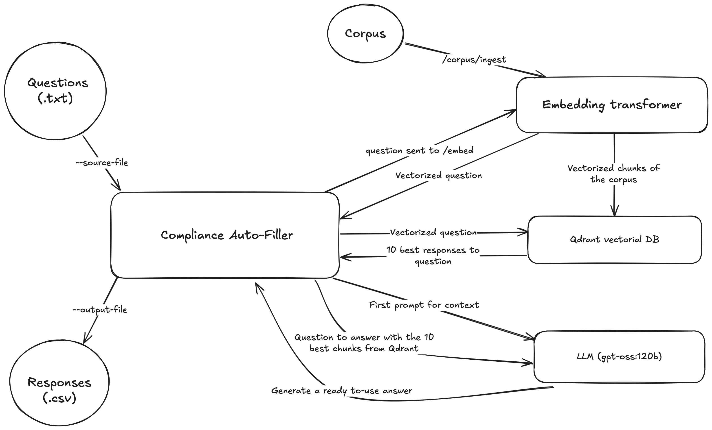

# Compliance Auto-Filler

## Description
The **Compliance Auto-Filler** is a tool that automates the completion of compliance questionnaires (RFPs, audits, vendor forms) using an organization's internal policies and documentation.

### How it works
It leverages:

- Qdrant as a vector database to store and query compliance policies and documents.

- A [Python API](https://github.com/milairhu/compliance-corpus-ingestor) embedding a model to handle document ingestion, corpus chunking, and vectorization.

- A locally hosted [LLM deployed with Ollama](./docker/llm), preprompted to generate short, ready-to-use answers.

- An Go CLI (this project) to read questions, feed policies and documents into the Qdrant database, ask the LLM questions with relevant context, and output responses.

### Input
So far, the CLI is fed with a text file containing questions.

### Output
The output is a csv file with questions and answers.

## Architecture



## Getting Started

The prerequisites are:
- have the compliance corpus ready in a **./corpus** folder
- have the questions ready in a **./questions.txt** file

```bash
docker compose up --build -d
```

This will start:
- Qdrant on http://localhost:6333
- The Ingestor on http://localhost:8000
- The Compliance Auto-Filler CLI
- A local LLM onn http://localhost:11434

The output will be in **./answers.csv**.

## Configuration

### LLM 

You can change the LLM model by editing the [docker/llm/Modelfile](./docker/llm/Modelfile) and [./pkg/llm/llm.go](./pkg/llm/llm.go) files. 

The chosen model must be compatible with Ollama. For a local test deployment, default is *deepseek-r1:8b*. If deployed on a server with a GPU, you can use a larger model like *gpt-oss:120b*